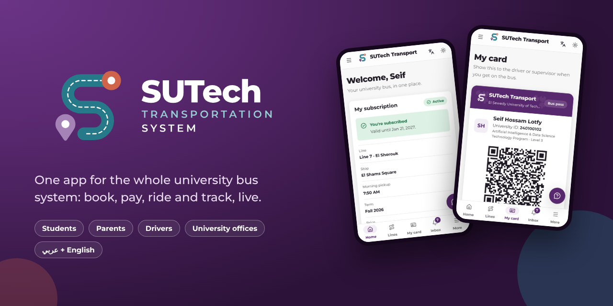
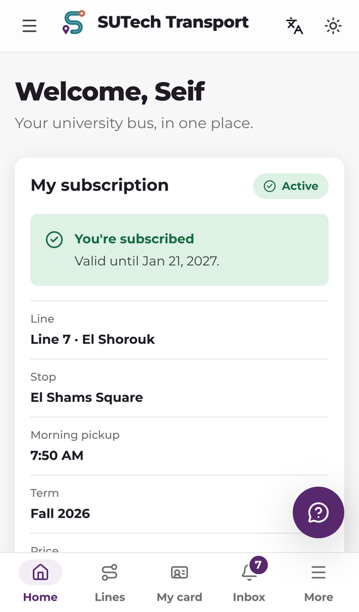
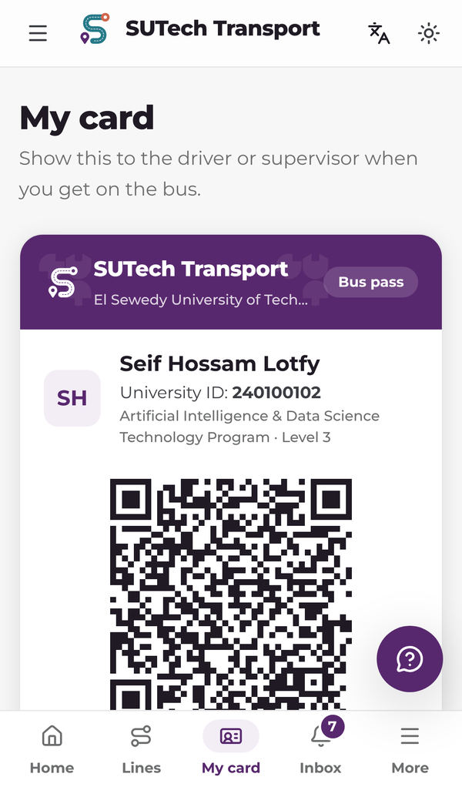
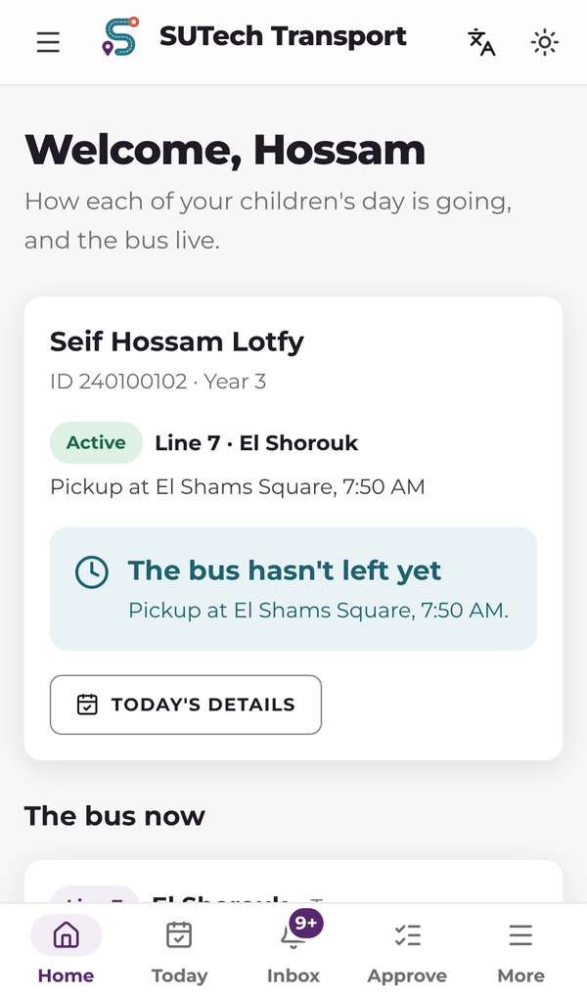
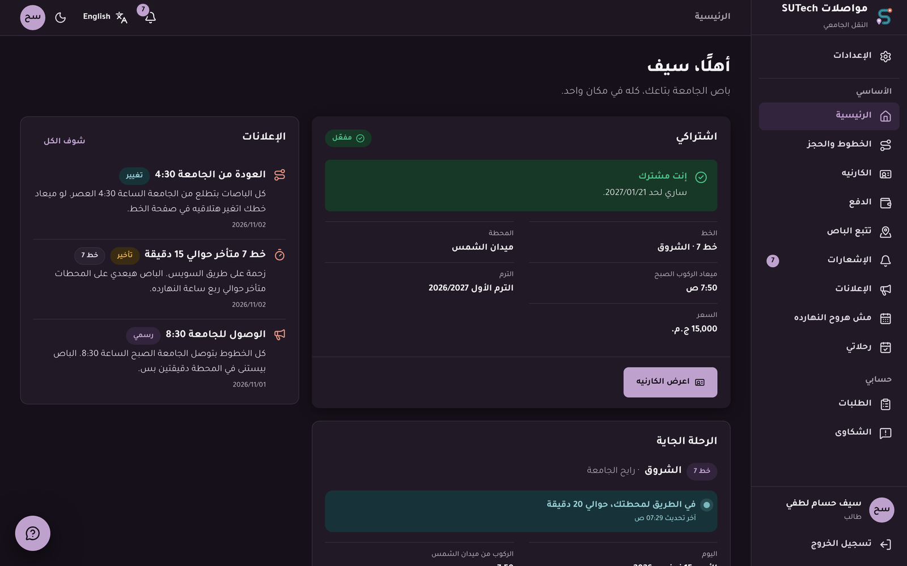
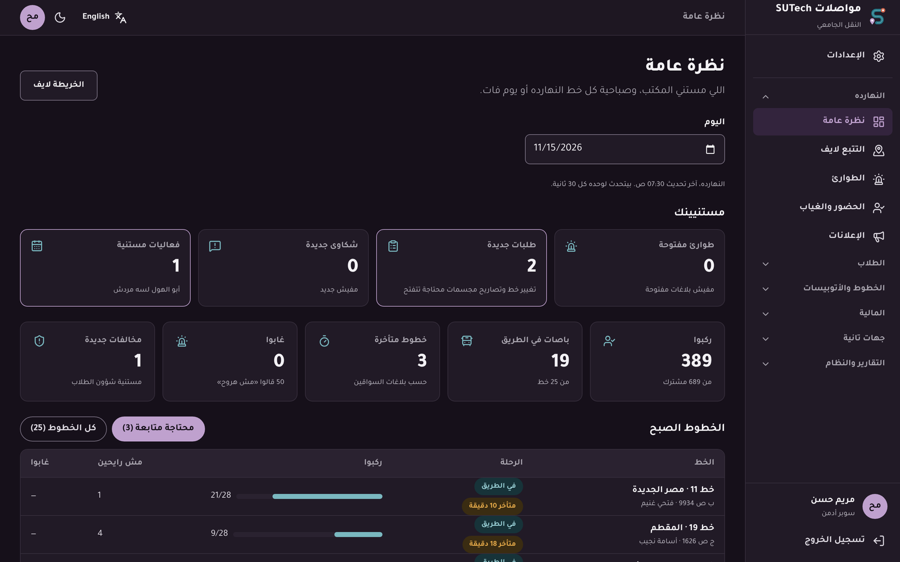
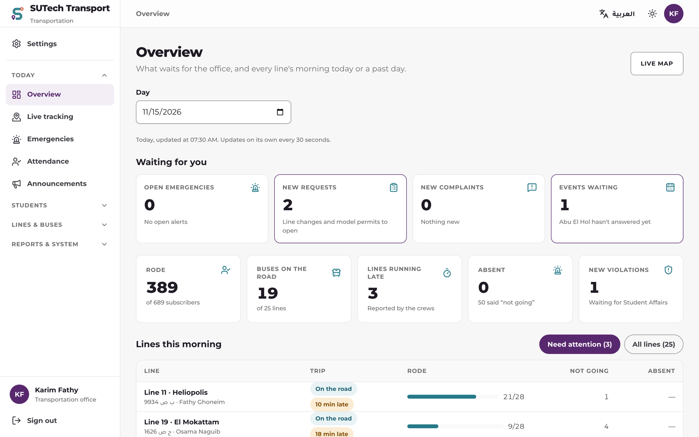
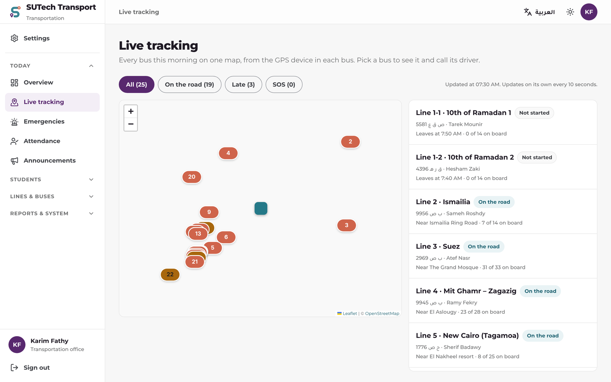
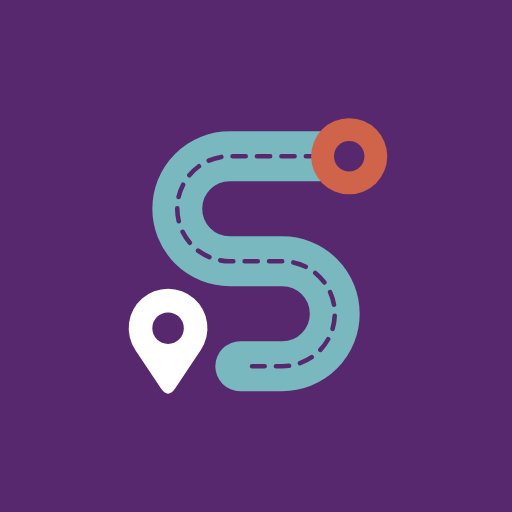

<div dir="rtl">

<div align="center">



<br>

**نظام أتوبيسات جامعة السويدي للتكنولوجيا (SUTech) كله في تطبيق واحد.**
<br>
الطالب يحجز كرسي ويدفع ويركب بكارنيه رقمي، وولي الأمر يتابع الأتوبيس، والسواق والمشرف يديروا الرحلة،
وكل مكتب في الجامعة ليه صفحاته. عربي وإنجليزي، فاتح وغامق، ويتسطب على أي موبايل.

<br>

[](https://sutech-transport.vercel.app)
[](README.md)

</div>

---

## 🚌 المشكلة

الجامعة عندها **23 خط و27 أتوبيس** من القاهرة والجيزة والمحافظات لحد الحرم الجامعي في العاشر من رمضان.
لحد دلوقتي كل حاجة ماشية بالورق والتليفونات وجروبات الواتساب: الطالب مش عارف الأتوبيس فين، الاشتراكات
والإيصالات بتتراجع بالإيد، ولي الأمر مش شايف الرحلة، ومكتب النقل معندوش صورة لايف للصبح.

**نظام مواصلات SUTech** بيجمع الرحلة كلها في مكان واحد، من حجز الكرسي لحد ما الأتوبيس يوصل الجامعة،
لكل اللي ليهم دور فيها.

## ▶️ جرّبه بنفسك

التجربة شغالة بالواجهة الحقيقية على سيرفر تجريبي جوه المتصفح (بيانات وهمية، ومفيش حاجة بتتحفظ على سيرفر).

1. افتح **[sutech-transport.vercel.app](https://sutech-transport.vercel.app)**.
2. اكتب رقم من الجدول ودوس **إرسال الكود**.
3. في وضع التجربة الكود بيظهر على الشاشة، اكتبه وهتدخل.

| تجرّب كـ | الرقم |
| --- | --- |
| 🎓 طالب مشترك | `240100102` |
| 🎓 طالب جديد (لسه محجزش) | `240100101` |
| 👨‍👩‍👦 ولي أمر | `01000002001` |
| 🚌 مشرف / سواق | `SUP-1001` / `DRV-1001` |
| 🏢 إدارة النقل | `TRN-1001` |
| 💳 المالية | `FIN-1001` |
| 🛡️ السوبر أدمن | `ADM-1001` |

## 📸 صور من التطبيق

<table>
  <tr>
    <td width="33%"></td>
    <td width="33%"></td>
    <td width="33%"></td>
  </tr>
  <tr>
    <td align="center"><b>الطالب</b>: الاشتراك والرحلة الجاية</td>
    <td align="center"><b>الكارنيه الرقمي</b>: QR بيتغير كل 30 ثانية</td>
    <td align="center"><b>ولي الأمر</b>: الأتوبيس فين واليوم ماشي إزاي</td>
  </tr>
</table>

| عربي، من اليمين للشمال، الوضع الغامق | السوبر أدمن |
| --- | --- |
|  |  |
| **إدارة النقل**: الصبح كله في نظرة | **تتبع كل الأتوبيسات لايف** |
|  |  |

## ✨ بيعمل إيه

تطبيق واحد و**12 دور**، وكل دور بيشوف صفحاته هو بس.

| مين | يقدر يعمل إيه |
| --- | --- |
| 🎓 **الطالب** | يشوف الخطوط والمحطات، يحجز وقت فتح الحجز، يدفع تحويل بنكي أو فيزا ويرفع الإيصال، كارنيه رقمي بـ QR، يتابع الأتوبيس لايف، "مش رايح النهارده"، طلب تغيير خط أو استرداد، شكاوى، إعلانات خطه، والمساعد الذكي. |
| 👨‍👩‍👦 **ولي الأمر** | يتابع يوم ابنه والأتوبيس لايف، يوافق على تغيير الخط، وبيوصله إشعار لما ابنه يركب ويوصل. |
| 🚌 **السواق والمشرف** | يبدأ الرحلة، يعمل سكان للكارنيه، يسجل مين ركب، يبلغ عن تأخير، وزرار **SOS** (طبي، عطل، حادثة) بمكان الأتوبيس بالظبط. |
| 🏢 **إدارة النقل** | خريطة لايف لكل الأتوبيسات، نظرة عامة على الصبح، الخطوط والأتوبيسات والحجز والحضور ومواعيد الرجوع وأتوبيسات الفعاليات والإعلانات والطلبات والشكاوى، وتقارير Excel وPDF. |
| 💳 **المالية** | مراجعة الإيصالات، تسجيل الدفع بالفيزا، والاسترداد. |
| 🏥 **العيادة** | استقبال حالات SOS الطبية ومتابعتها. |
| 📋 **شؤون الطلاب** | المخالفات والإنذارات والإيقاف والحظر. |
| 🏛️ **الأمين العام، شركة أبو الهول، السوبر أدمن** | الموافقات، صفحات شركة الأتوبيسات، حسابات الموظفين وسجل العمليات. |

## 🧰 التقنيات

| الجزء | الأدوات |
| --- | --- |
| الواجهة | Next.js 16 و React 19 و TypeScript و Tailwind CSS 4 و next-intl و Zod و Leaflet و PWA |
| السيرفر | Python و FastAPI و PostgreSQL و Alembic (فريق الباك إند شغال عليه) |
| الذكاء الاصطناعي | Python و FastAPI و Google Gemini وبحث بالـ vectors |
| الجودة | Vitest و Playwright على موبايل ولابتوب، وفحص سهولة الوصول (axe)، و ESLint و Prettier |
| النشر | GitHub Actions و Vercel |

## 📈 وصلنا لفين

| الجزء | الحالة |
| --- | --- |
| الواجهة لكل الـ 12 دور | ✅ خلصت واتختبرت |
| الهوية البصرية واللوجو | ✅ خلصت |
| الاتفاق بين الواجهة والسيرفر | ✅ متفق عليه ([عربي](docs/backend-agreement/SUtech-Frontend-Backend-Agreement.ar.md) · [English](docs/backend-agreement/SUtech-Frontend-Backend-Agreement.en.md)) |
| السيرفر (FastAPI) | 🔄 الأساس اترفع ([`mohamed-ali/backend`](mohamed-ali/backend/))، والموديولات جاية |
| المساعد الذكي | 🔄 شغالين عليه |
| أجهزة GPS الحقيقية وتجربة على خط | ⏳ الخطوة الجاية |

## 👥 الفريق

مشروع طلابي لبرنامج **علوم البيانات والذكاء الاصطناعي** في **جامعة السويدي للتكنولوجيا (SUTech)**،
مقدَّم لوحدة المشروعات بالجامعة، ترم خريف 2026.

**المشرفة:** د. نهال أنيس منصور

| الفريق | الأعضاء |
| --- | --- |
| 🎨 **الواجهة (Front End)** | [**أحمد الدمرداش**](https://github.com/Ahmed-Aldmrdash) (قائد الفريق)، **شيماء حسين، معاذ عبد الجواد** |
| ⚙️ **السيرفر (Back End)** | **عبدالله محمد أحمد، محمد علي ، أحمد شفيق رجب، محمد نبيل عرفة** |
| 🤖 **البيانات والذكاء الاصطناعي** | [**عمر احمد رمضان**](https://github.com/OmarAhmedRamadan07)، أبانوب رضا |
| 🔐 **الأمن السيبراني** | محمود حمادة |

## 🚀 تشغيله على جهازك

محتاج **Node 22.12** أو أحدث.

</div>

```bash
git clone https://github.com/Ahmed-Aldmrdash/sutech-transport.git
cd sutech-transport/frontend
cp .env.example .env.local
npm install
npm run dev
```

<div dir="rtl">

وبعدها افتح `http://localhost:3000`. التفاصيل كلها في [frontend/README.md](frontend/README.md)، وفهرس الملفات في [docs/README.md](docs/README.md).

---

<div align="center">



**نظام مواصلات SUTech** · جامعة السويدي للتكنولوجيا · 2026

<sub>كل الأسماء والأرقام في التجربة وهمية.</sub>

</div>

</div>
