<div align="center">

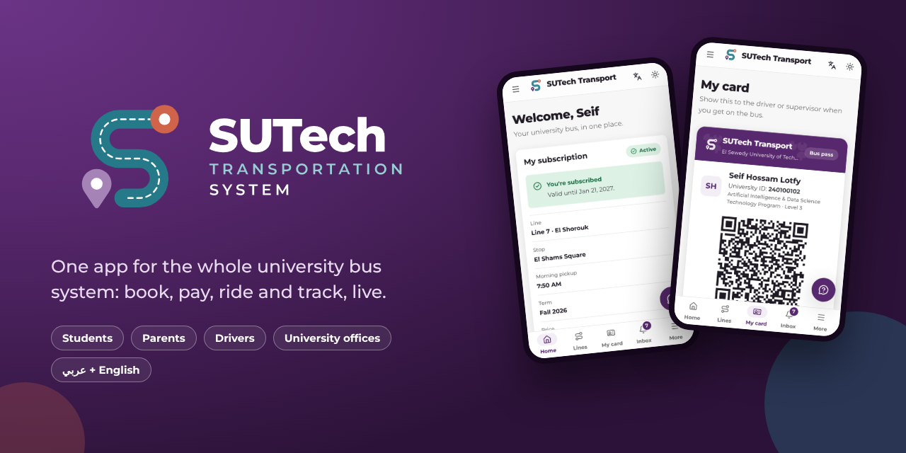

<br>

**The university bus system of El Sewedy University of Technology (SUTech), in one app.**
<br>
Students book a seat, pay and ride with a digital card. Parents follow the bus. Drivers and supervisors run the trip.
Every university office gets its own desk. Arabic and English, light and dark, installable on any phone.

<br>

[](https://sutech-transport.vercel.app)
[](README.ar.md)

[](https://github.com/Ahmed-Aldmrdash/sutech-transport/actions/workflows/frontend.yml)


[Live demo](https://sutech-transport.vercel.app) ·
[Screenshots](#-screenshots) ·
[Features](#-what-it-does) ·
[Architecture](#-architecture) ·
[Team](#-team) ·
[Docs](docs/README.md)

</div>

---

## 🚌 The problem

SUTech runs **23 bus lines and 27 buses** from Cairo, Giza and the governorates to the campus in 10th of
Ramadan City. Until now everything ran on paper, phone calls and WhatsApp groups: students did not
know where their bus was, subscriptions and receipts were checked by hand, parents had no view of
the trip, and the transport office had no live picture of the morning.

**SUTech Transportation System** puts the whole journey in one place, from booking a seat to the bus
arriving on campus, for everyone involved.

## ▶️ Try it

The live demo runs the real front end on a built-in mock server (made-up data, nothing is saved on a server).

1. Open **[sutech-transport.vercel.app](https://sutech-transport.vercel.app)**.
2. Type one of the IDs below and press **Send code**.
3. In demo mode the one-time code is shown on the screen. Type it and you are in.

| Try as | ID |
| --- | --- |
| 🎓 Student with an active subscription | `240100102` |
| 🎓 New student (no booking yet) | `240100101` |
| 👨‍👩‍👦 Parent | `01000002001` |
| 🚌 Bus supervisor / driver | `SUP-1001` / `DRV-1001` |
| 🏢 Transportation office | `TRN-1001` |
| 💳 Finance office | `FIN-1001` |
| 🛡️ Super admin | `ADM-1001` |

More accounts (clinic, student affairs, Secretary General, the bus company) are listed in
[frontend/README.md](frontend/README.md#run-it).

## 📸 Screenshots

<table>
  <tr>
    <td width="33%">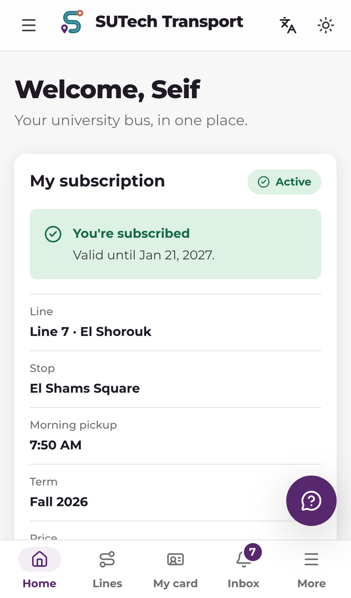</td>
    <td width="33%">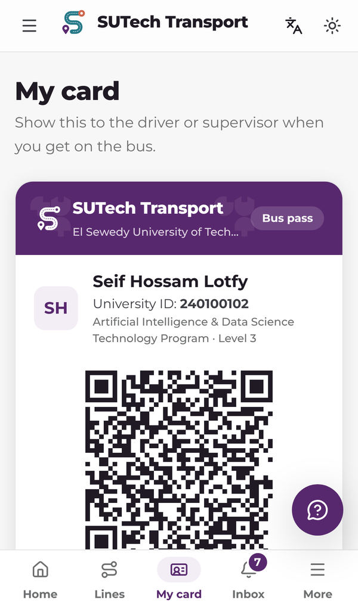</td>
    <td width="33%">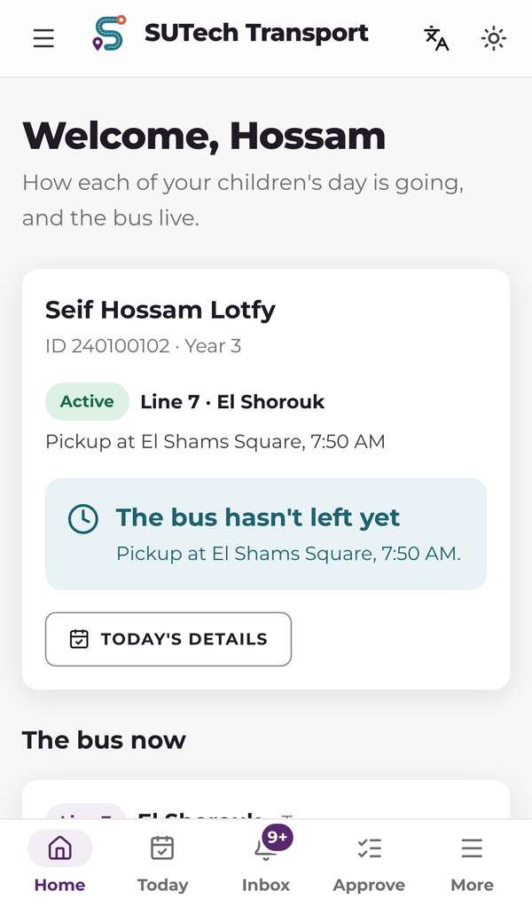</td>
  </tr>
  <tr>
    <td align="center"><b>Student</b>: subscription, next trip, live status</td>
    <td align="center"><b>Digital card</b>: QR that changes every 30 seconds</td>
    <td align="center"><b>Parent</b>: where the bus is and how the day is going</td>
  </tr>
</table>

| Transportation office: the whole morning at a glance | Live tracking of every bus |
| --- | --- |
| 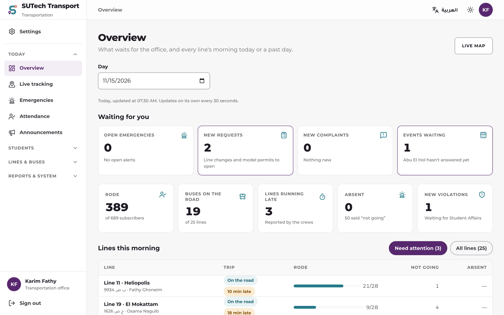 | 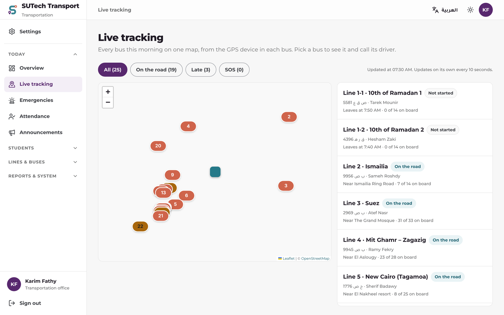 |
| **Lines and booking** for students | **Reports** exported to Excel and PDF |
| 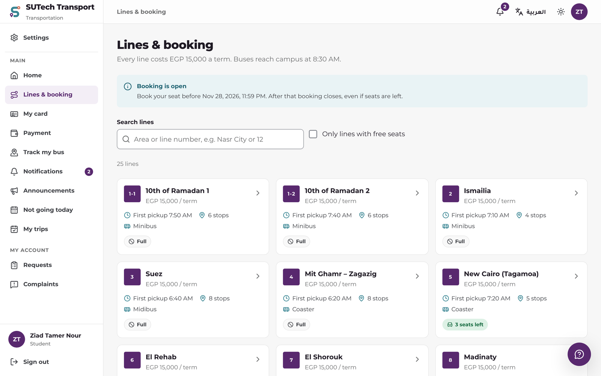 | 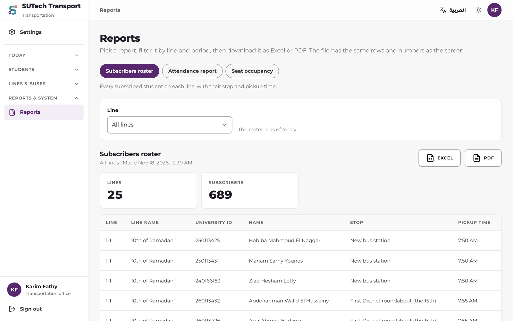 |
| **Arabic, right to left, dark mode** | **Sign in** with a one-time code |
| 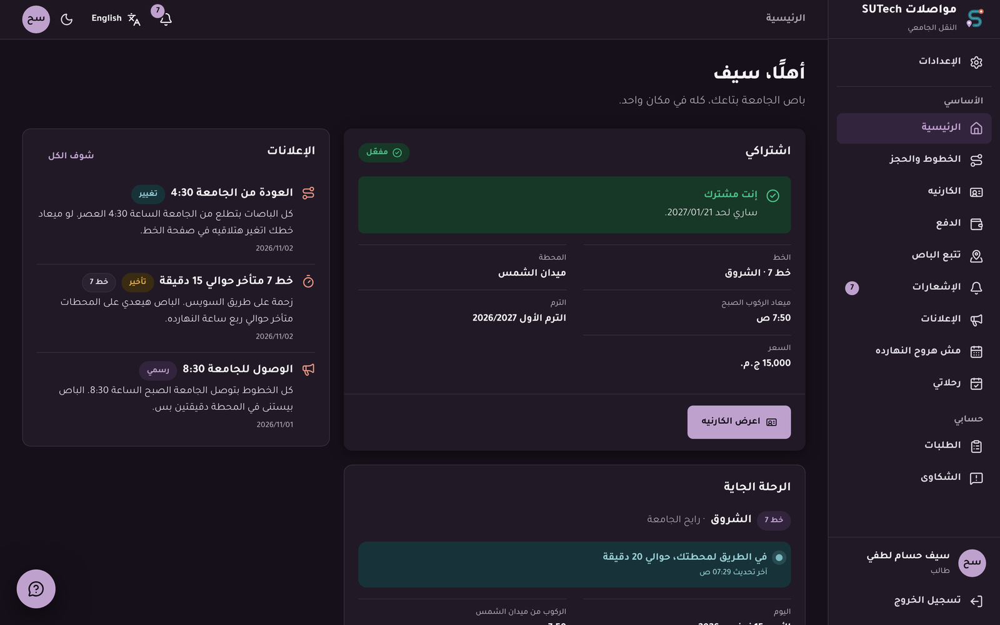 | 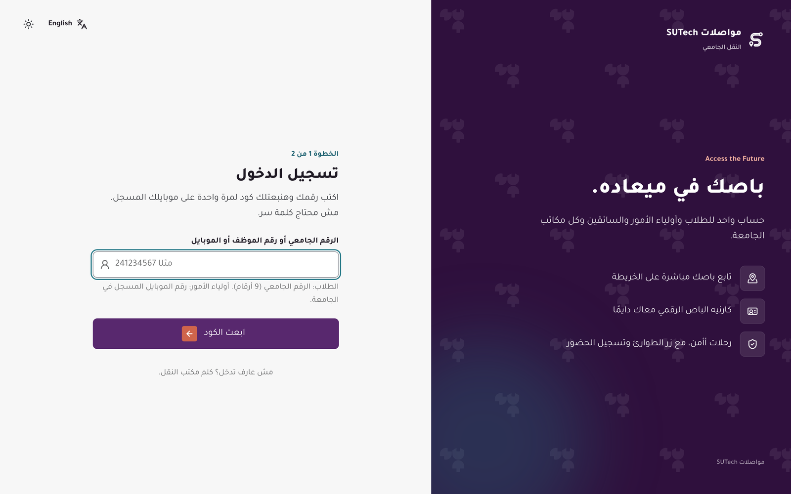 |

<details>
<summary><b>More screenshots</b></summary>

| Finance: receipts waiting for review | Super admin, Arabic, dark mode |
| --- | --- |
| 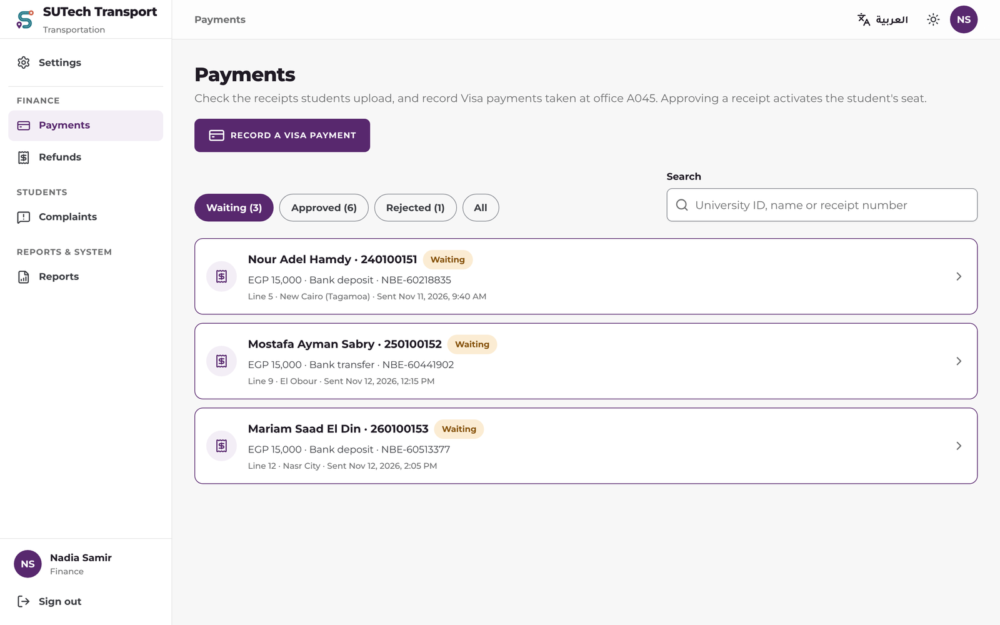 | 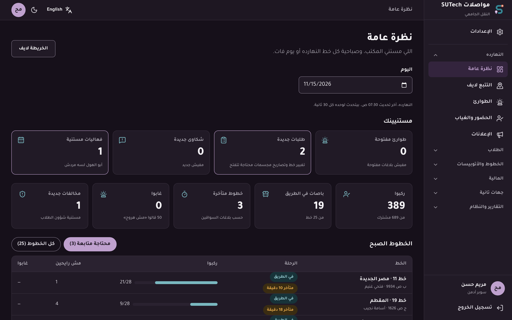 |

<p align="center">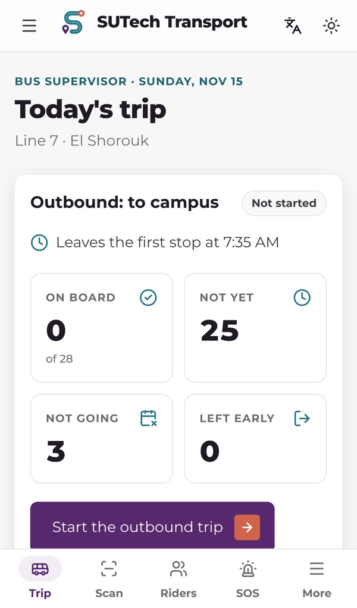<br><b>Bus supervisor</b>: today's trip, who is on board, SOS</p>

</details>

## ✨ What it does

One app, **12 roles**, and each role sees only its own pages.

| Who | What they can do |
| --- | --- |
| 🎓 **Student** | Browse the lines and stops, book a seat while booking is open, pay by bank transfer or Visa and upload the receipt, carry a digital bus card with a rotating QR, track the bus live, say "not going today", request a line change or a refund, file complaints, read line announcements, ask the AI assistant. |
| 👨‍👩‍👦 **Parent** | See each child's day and the bus live, approve line-change requests, get notified when the child boards and arrives. |
| 🚌 **Driver and supervisor** | Start the trip, scan student cards, mark who boarded, report a delay, press **SOS** (medical, breakdown, accident) with the exact bus location. |
| 🏢 **Transportation office** | A live map of all buses, the morning overview, lines, buses, bookings, attendance, return times, events buses, announcements, requests, complaints, reports in Excel and PDF. |
| 💳 **Finance** | Review receipts, record Visa payments, handle refunds. |
| 🏥 **Clinic** | Receive medical SOS alerts and follow them up. |
| 📋 **Student affairs** | Violations, warnings, suspensions and bans. |
| 🏛️ **Secretary General, bus company (Abu El Hol), super admin** | Approvals, the bus company's desk, staff accounts and the audit log. |

**Built to last:** installable PWA that works on weak networks, Arabic first with full right to left
support, light and dark modes, accessible (checked with axe), and a clean API contract so the
back end can be plugged in without changing a screen.

## 🏗️ Architecture

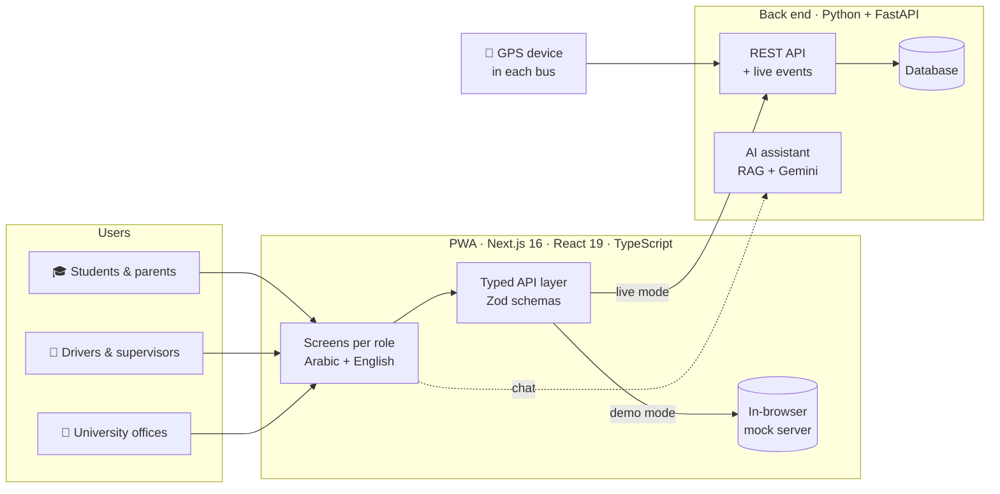

- **One contract.** Every endpoint is defined once in the front end with a Zod schema and exported to
  [`frontend/openapi.json`](frontend/openapi.json) (over 90 operations). The Back End team builds
  against it, and switching from demo to live is one setting: `NEXT_PUBLIC_API_MODE=live`.
- **Tracking** comes from a GPS device installed in each bus, not from the driver's phone.
- **The AI assistant** ([`assistant/`](assistant/)) answers students' questions from the
  university's real transport rules, using retrieval over a knowledge base and Gemini.

## 🧰 Tech stack

| Layer | Tools |
| --- | --- |
| Front end | Next.js 16 (App Router, Turbopack), React 19, TypeScript, Tailwind CSS 4, next-intl, Zod, Leaflet, Serwist (PWA), Lucide icons |
| Back end | Python, FastAPI, SQLAlchemy (async), PostgreSQL, Alembic, Docker Compose (in progress by the Back End team) |
| AI | Python, FastAPI, Google Gemini, NumPy vector search |
| Quality | Vitest + Testing Library, Playwright end-to-end on phone and laptop, axe accessibility checks, ESLint, Prettier, Knip |
| Delivery | GitHub Actions CI, Vercel |
| Design | Our own design system based on the official SUTech brand manual ([docs/design-system](docs/design-system/)) |

## 📁 Repository layout

```
frontend/          The production PWA (Next.js + TypeScript)
  openapi.json     Every endpoint the app calls: the contract for the back end
assistant/         The AI assistant service (FastAPI + Gemini) with a chat page
mohamed-ali/backend/  The FastAPI back end foundation (PostgreSQL, Alembic), being built by the Back End team
docs/
  backend-agreement/  Front end ↔ back end agreement (Arabic + English)
  design-system/      Colours, type, tokens and a live style guide
  reports/            Test and security reports
  screenshots/        The images in this README
  assets/             Logo and banner
index.html         The first clickable prototype (kept for history)
```

## 🚀 Run it locally

Needs **Node 22.12+**.

```bash
git clone https://github.com/Ahmed-Aldmrdash/sutech-transport.git
cd sutech-transport/frontend
cp .env.example .env.local   # demo mode, no server needed
npm install
npm run dev                  # http://localhost:3000
```

| Command | What it does |
| --- | --- |
| `npm run dev` | Development server |
| `npm run build && npm run start` | Production build (use this to judge speed) |
| `npm run check` | Types, lint, formatting, unused code and unit tests |
| `npm run e2e` | End-to-end tests on a phone and a laptop viewport |
| `npm run openapi` | Regenerates the API contract for the back end |

The AI assistant has its own guide in [assistant/README.md](assistant/README.md), and the back end in
[mohamed-ali/backend/README.md](mohamed-ali/backend/README.md).

## 📈 Project status

| Part | Status |
| --- | --- |
| Front end, all 12 roles | ✅ Done and tested (unit, end-to-end, accessibility) |
| Design system and logo | ✅ Done |
| API contract with the back end | ✅ Agreed ([English](docs/backend-agreement/SUtech-Frontend-Backend-Agreement.en.md) · [العربية](docs/backend-agreement/SUtech-Frontend-Backend-Agreement.ar.md)) |
| Back end (FastAPI) | 🔄 In progress: the foundation is merged ([`mohamed-ali/backend`](mohamed-ali/backend/)), feature modules are next |
| AI assistant | 🔄 In progress |
| Real GPS devices and live pilot | ⏳ Next |

## 👥 Team

A student project of the **Data Science & AI Technology** program at
**El Sewedy University of Technology (SUTech)**, submitted to the university's Projects Unit, Fall 2026.

**Supervisor:** Dr. Nehal Anees Mansour

| Team | Members |
| --- | --- |
| 🎨 **Front End** | [**Ahmed Aldmrdash**](https://github.com/Ahmed-Aldmrdash) (team leader), **Shimaa Hussien, Moaaz Abd Aljawwad** |
| ⚙️ **Back End** | **Abdullah Mohammed Ahmed, Mohamed Ali Mohamed Ali, Ahmed Shafiq Ragab, Mohamed Nabile Arafa** |
| 🤖 **Data & AI** | [**Omar Ahmed Ramadan**](https://github.com/OmarAhmedRamadan07), **Abanoub Reda** |
| 🔐 **Cyber Security** | **Mahmoud Hamada** |

## 📚 Documentation

| Document | For |
| --- | --- |
| [Docs index](docs/README.md) | Everything below in one place |
| [Front end guide](frontend/README.md) | Developers: accounts, scripts, architecture |
| [Back end agreement](docs/backend-agreement/SUtech-Frontend-Backend-Agreement.en.md) | The Back End team |
| [Design system](docs/design-system/DESIGN-SYSTEM.md) | Designers and front end |
| [Contributing](CONTRIBUTING.md) | How we branch, test and review |

---

<div align="center">

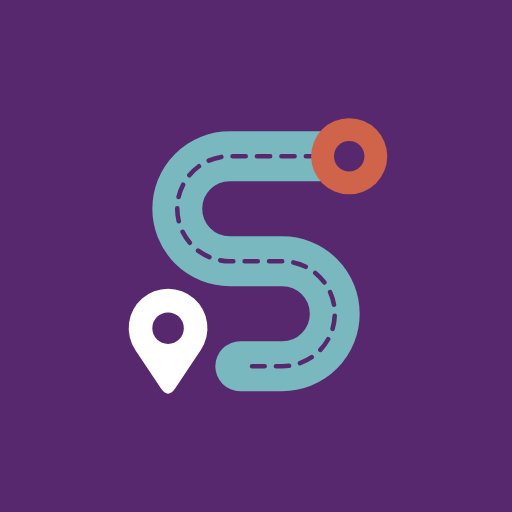

**SUTech Transportation System** · El Sewedy University of Technology · 2026

<sub>All names, IDs and phone numbers in the demo are made up.</sub>

</div>
