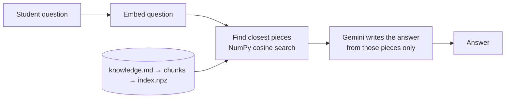

# SUTech Transport AI assistant

The chat assistant that answers students' questions about the university buses: lines, stops,
times, prices, booking, refunds and the rules. Built by the **Data & AI team**
([**Omar Ahmed Ramadan**](https://github.com/OmarAhmedRamadan07), **Abanoub Reda**).

It answers only from the university's own transport information, so it does not make things up:

1. `data/knowledge.md` holds the official transport information (routes, times, prices, rules).
2. It is split into small pieces in `data/chunks.jsonl`.
3. `build_index.py` turns every piece into a vector with Gemini embeddings (`data/index.npz`).
4. For each question, the closest pieces are found with NumPy and given to a Gemini model,
   which writes the answer in the student's language (Arabic, Egyptian Arabic or English).



## Run it

Needs Python 3.12+ and a Gemini API key.

```bash
cd assistant
python -m venv .venv
source .venv/bin/activate        # Windows: .venv\Scripts\activate
pip install -r requirements.txt
cp .env.example .env             # put your GEMINI_API_KEY in .env
python build_index.py            # once, and again whenever the knowledge changes
python search.py                 # chat in the terminal (--debug shows the pieces found)
uvicorn app:app --reload         # or run the server: open http://127.0.0.1:8000 for the chat page
```

`python search.py --models` lists the Gemini models your key can use. `python test_bot.py` runs
the 100-question evaluation set.

## Files

| File | What it does |
| --- | --- |
| `app.py` | FastAPI server: `POST /chat`, `GET /health`, and the chat page at `/` |
| `chat.html` | A simple chat page to try the assistant in the browser |
| `search.py` | Retrieval + answer, also a terminal chat |
| `build_index.py` | Builds the vector index |
| `common.py` | Shared settings and the embedding call |
| `test_bot.py` | 100 real questions to measure answer quality |
| `data/` | The knowledge base and its pieces |

The API key lives only in `.env`, which is never committed.
